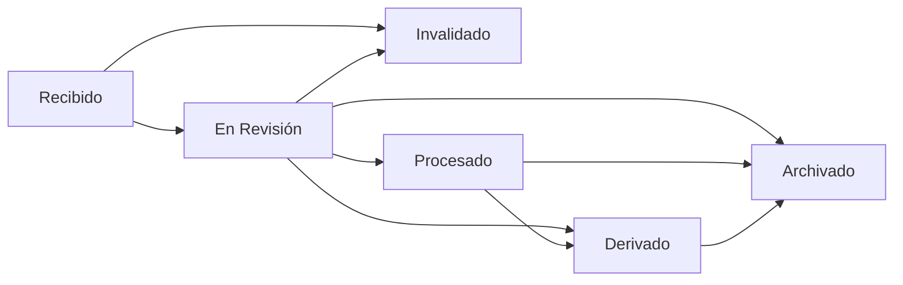

Contraloría del Municipio Páez · Sistema CGP · corte: 4 de noviembre de 2026

# Handoff técnico para quien redacta el trabajo de proyecto

Este documento dice qué hace de verdad el sistema, según su código, para que compruebes si el trabajo escrito dice lo mismo. Regla de oro: si el trabajo y el código no coinciden, manda el código, salvo que el equipo decida cambiar el sistema.

**Lo que este cotejo todavía no hizo.** El trabajo escrito no estaba en el repositorio, así que nadie lo ha comparado todavía línea por línea. Esa comparación es tu tarea, y este documento te da la referencia. Tampoco se ejecutó la aplicación ni las pruebas para prepararlo: todo sale de leer el código, porque Docker y Postgres estaban apagados.

Tampoco se encontró el documento de requisitos. Los códigos `RQF-xx` solo aparecen como comentarios en el esquema SQL.

1. Cómo hacer el cotejo
2. Diferencias más importantes
3. Sistema frente al Manual
4. Tecnología
5. Módulos y funciones
6. Flujos y reglas
7. Base de datos
8. Seguridad
9. Pruebas e instalación
10. Lo que no se debe afirmar
11. Lista de cotejo por capítulo
12. Fuentes y archivos
13. Preguntas para el equipo

## 1. Cómo hacer el cotejo

1. Marca en el trabajo cada afirmación técnica: tecnología, cantidad de tablas, roles, estados, formatos, plazos, validaciones y resultados de pruebas.
2. Búscala en este documento y confirma en el archivo citado si tienes dudas.
3. Clasifícala: **Coincide**, **Parcial** o **No existe**.
4. Para cada diferencia, corrige el texto o anótala para que el equipo decida si cambia el sistema. No escribas como hecho algo que solo está planificado: redáctalo como limitación o trabajo futuro.

Tabla sugerida para tu registro:

| Página del trabajo | Lo que afirma | Lo que hace el sistema | Resultado | Acción |
| --- | --- | --- | --- | --- |
| Ej.: p. 42 | Número CMP-DAC-D-… | Genera OAC-2026-00001 | **No coincide** | Corregir texto o cambiar sistema |

## 2. Las diferencias más importantes

Revisa estas primero. Son las que más probablemente choquen con un texto basado en el Manual o en el diseño original.

| Tema | Manual o documentación | Sistema real |
| --- | --- | --- |
| **Número de expediente** | Formato `CMP-DAC-D-01-25-001`, con letra según el mecanismo: D, Q, R o P. *(Manual p. 22)* | Genera `OAC-2026-00001`: correlativo anual único, sin letra por tipo. *(db.sql, fn_generate_case_number)* |
| **Plazo de 5 días hábiles** | Se otorga cuando faltan requisitos para subsanar. *(Manual p. 15 y 19)* | Calcula 7 días calendario desde la protocolización, para todo expediente. No descuenta feriados ni depende de que falten requisitos. *(db.sql, fn_set_docs_deadline)* |
| **Estado de subsanación** | La notificación prevé fases de análisis y de subsanación. *(Manual p. 43)* | No hay estado de subsanación. Los estados son Recibido, En Revisión, Procesado, Derivado, Archivado e Invalidado. |
| **Documentos del expediente** | Hoja de apertura, constancia, valoración, oficios, certificación, autos y acta. *(Manual p. 21 y anexos p. 36-48)* | Solo genera un PDF: la Planilla de Recepción. Ninguno de los demás se produce en el sistema. *(resources/views/pdf/planilla.blade.php)* |
| **Soportes físicos** | Control de consignación de recaudos. | Las columnas existen, pero ninguna pantalla marca la consignación. Por eso el reporte “vencidos” puede listar expedientes que sí consignaron. *(case_file.physical_docs_*; ReporteController)* |
| **Notificaciones** | Comunicar decisiones y resultas al ciudadano. *(Manual p. 13, 19 y 20)* | El sistema no envía correos ni avisos. El ciudadano consulta su estatus en el portal con su código. |
| **Asesorías** | Son un mecanismo que atiende la Dirección. *(Manual p. 12-13)* | El formulario solo ofrece Denuncia, Queja, Reclamo, Petición y Sugerencia. |
| **Requisitos de consulta popular** | El código SITUR y el señalamiento de testigos figuran como requisitos mínimos. *(Manual p. 18-19)* | SITUR es opcional. No hay campo para testigos, solo la narración y el adjunto “C.I. del testigo”. |
| **Fecha de los hechos** | “Fecha de ocurrencia, de ser el caso”. *(Manual p. 14)* | El formulario no la pide. La columna `incident_date` existe pero queda vacía. |
| **Nombre de la dependencia** | “Dirección de Atención al Ciudadano (DAC)”; algunos modelos del Manual dicen “Oficina”. | Código, pantallas y números usan “OAC”. |

### La documentación del propio repositorio también tiene errores

No copies estos puntos al trabajo sin corregirlos:

| Dónde | Dice | En realidad |
| --- | --- | --- |
| `docs/CREAR_USUARIO.md` | `REPORTS` da acceso a Administración. | Da acceso a OAC (`StaffUser::MODULOS`; ruta `/oac/reportes`). |
| `docs/CREAR_USUARIO.md` | Un trigger impide desactivar un cargo con personal activo. | El trigger solo impide *borrarlo*. Impedir la desactivación lo hace `CatalogoController`. |
| Comentario en `staff_privilege` | Los cambios rigen desde la siguiente sesión. | Rigen desde la siguiente página que abra el usuario. |
| Comentario en `evidence_file` | Los archivos van a S3 o MinIO. | Se guardan en el disco local del servidor (`storage/app/private`). |
| Comentario en `v_public_case_tracking` | La consulta pública usa esta vista y una línea de tiempo. | La vista no se usa. `DenunciaController@estado` consulta las tablas y devuelve solo el estatus actual. |
| Módulo `STATS` | Se llama “Criterios Estadísticos”. | Controla el Monitoreo de sesiones y accesos. Las estadísticas están en `REPORTS`. |

## 3. Sistema frente al Manual de la Dirección

Referencia: Resolución N.° CMP-013-2026 del 05/03/2026, Gaceta Municipal Extraordinaria N.° 048-C03-2026. Las páginas citadas son las impresas en el Manual; el PDF escaneado las tiene desordenadas y conviene revisar la p. 47, que no se identificó entre las fotos.

| Exigencia del Manual | Estado | Cómo lo cubre el sistema |
| --- | --- | --- |
| Recibir por canales tecnológicos (p. 17) | **Sí** | Formulario público por pasos en `/denuncias`. |
| Planilla de Recepción, 40 campos (p. 32-35) | **Sí** | PDF numerado como la planilla oficial. Firma, huella y sello quedan en blanco para hacerlos en papel. |
| Identificación plena; no anónimos (p. 14) | **Sí** | Documento, nombres, correo, celular y dirección son obligatorios. |
| Declaración de veracidad (campo 36) | **Sí** | Aceptación obligatoria; guarda fecha y hora. |
| Clasificar por mecanismo (p. 14) | **Sí** | Cinco tipos. Lo elige el ciudadano; no hay pantalla para que el funcionario lo corrija. |
| Consulta popular nacional (p. 18) | **Parcial** | Bloque propio solo en denuncias. SITUR es opcional. |
| Registro automatizado (p. 13, punto 16) | **Sí** | Expedientes con búsqueda y filtros. |
| Conocer el estado del trámite (p. 6, punto 5) | **Parcial** | Muestra el estatus actual por código. No muestra el historial ni qué funcionario lo tramita (p. 6, punto 6). |
| Reportes estadísticos periódicos (p. 13, punto 20) | **Sí** | Por rango de fechas, con descarga CSV. |
| Relación mensual a Auditoría Interna (p. 10 y 13) | **Parcial** | Se puede filtrar un mes y descargar CSV con totales. No hay un informe que liste cada denuncia. |
| Remitir al Contralor o al órgano competente (p. 21) | **Parcial** | Estado “Derivado” con unidad y enlace al oficio. El catálogo trae Control Posterior y Potestad Investigativa. No hay flujo de aprobación del Contralor. |
| Admisibilidad en 3 días hábiles y remisión en 15 (p. 18-19) | **No** | El sistema no controla estos plazos. |
| Informe de Valoración (p. 21, 37-39) | **Parcial** | Hay tipificación y notas del analista. No genera el informe. |
| Foliatura, piezas y autos (p. 22-24) | **No** | Sigue siendo proceso físico. Existe `physical_file_number` sin pantalla que lo use. |
| Cierre con auto aprobado por el Contralor (p. 24-25) | **No** | Cualquier usuario con permiso de escritura puede archivar con una observación. |
| Reserva de identidad (p. 13 y 18) | **Parcial** | La consulta de estatus no revela datos. El enlace de la planilla sí los muestra a quien tenga el código de seguimiento; dentro del panel se ven con permiso de expedientes. |
| Libro de préstamo de expedientes (p. 24) | **No** | El sistema no registra quién consulta un expediente, solo quién actúa sobre él. |
| Informes públicos (p. 8, punto 17) | **Parcial** | Informes en PDF para Contraloría Escolar y Gestión Comunitaria. Revisa si corresponden al informe trimestral de uso de recursos. |

## 4. Tecnología

|  |  |
| --- | --- |
| Backend | PHP con Laravel 13. Composer exige PHP 8.3 o superior; la imagen Docker usa PHP 8.4. |
| Base de datos | PostgreSQL 17 con extensiones `pgcrypto` y `unaccent`. El comentario del esquema menciona “15+”, pero Docker usa 17. |
| Interfaz | Plantillas Blade, CSS propio, clases Bootstrap y JavaScript sin framework (`public/assets/js/wizard.js`). |
| PDF | `barryvdh/laravel-dompdf`. El PDF se genera al pedirlo y no se almacena. |
| Despliegue actual | Docker Compose con dos contenedores: aplicación en el puerto 8001 y base de datos. Usa `php artisan serve`, que es un servidor de desarrollo. |
| Arquitectura | Monolito MVC en un solo código. No hay API separada ni aplicación móvil. La carpeta `design/` es solo la maqueta HTML. |
| Historia | 114 commits entre el 02/05/2026 y el 18/10/2026. Hubo un `cgp-express` anterior que ya no está en el repositorio: no lo cites como arquitectura vigente. |

## 5. Módulos y funciones

### Portal público (sin inicio de sesión)

| Ruta | Función |
| --- | --- |
| `/` | Inicio con servicios, preguntas frecuentes, misión y visión, noticias, Instagram y Base Normativa con buscador. Misión, visión y noticias vienen del gestor de contenido. |
| `/denuncias` | Formulario por pasos. Guarda un borrador en el navegador durante 2 horas. Adjuntos de hasta 10 MB por archivo. |
| `/denuncias/estado` | Consulta por número de expediente o código de seguimiento. Límite: 30 consultas por minuto. |
| `/denuncias/{código}/planilla` | Planilla en PDF, hoja carta. |
| `/contraloria-escolar`, `/gestion-comunitaria` | Informes publicados por período. |
| `/organigrama` | Página fija; no usa el tipo de contenido “Organigrama”. |

### Panel OAC (`/oac`)

- **Inicio:** indicadores y últimos movimientos.
- **Expedientes:** lista paginada de 20 en 20, filtros por estado y tipo, búsqueda por número, cédula o nombre.
- **Detalle:** datos, adjuntos, historial, observaciones, cambio de estatus, tipificación y derivación.
- **Reportes:** total, cerrados, porcentaje de cierre, por estatus, tipo, irregularidad y mes, soportes vencidos y CSV. No exporta PDF ni tiene gráficos propios de exportación.
- **Catálogos:** tipos de trámite, irregularidades, unidades de derivación, tipos de señalado y documentos físicos. Se desactivan, no se borran.

### Panel Administración (`/admin`)

- **Usuarios:** altas, activación y permisos por módulo. La clave no se cambia desde el panel: se hace por consola.
- **Monitoreo:** sesiones activas, accesos denegados, cambios de permisos, historial de ingresos, bloqueos, uso de disco, cierre forzado de sesión y desbloqueo.
- **Contenido web:** crear y editar, publicar o dejar en borrador, Markdown e historial de versiones. El historial muestra título, autor y fecha, y no permite restaurar ni eliminar contenido.
- **Informes:** PDF de hasta 20 MB e imagen opcional de hasta 4 MB. Es de lo poco que sí se borra de forma definitiva.
- **Cargos:** catálogo de cargos del personal.

### Permisos

No hay roles fijos. Cada usuario tiene leer, escribir o borrar por cada uno de los 8 módulos. Escribir incluye leer, y borrar incluye escribir. Si el trabajo describe roles como “Administrador” o “Analista”, aclara que son cargos o combinaciones de permisos. El selector del inicio de sesión solo indica a qué panel entrar.

| Panel | Código | Nombre en el sistema |
| --- | --- | --- |
| OAC | `CASES` | Gestión de Expedientes |
| OAC | `CLASSIFY` | Clasificación y Derivación |
| OAC | `CATALOGS` | Gestión de Catálogos |
| OAC | `REPORTS` | Reportes e Informes |
| Admin | `USERS` | Gestión de Usuarios |
| Admin | `ACCESS` | Gestión de Accesos |
| Admin | `STATS` | Criterios Estadísticos (Monitoreo) |
| Admin | `CMS` | Gestión de Página Web |

## 6. Flujos y reglas

### Estados del expediente



- Archivado e Invalidado son finales. Cualquier otro cambio se rechaza en el servidor.
- Pasar a En Revisión es lo que el sistema llama **protocolizar**: guarda la fecha, el funcionario y el plazo de soportes.
- Derivar exige permiso `CLASSIFY` de escritura y una unidad. El enlace al oficio es opcional.
- Cada cambio exige una observación de 5 a 2000 caracteres y queda en el historial.
- Si dos personas editan a la vez, la segunda recibe un aviso y no sobrescribe (bloqueo de fila).

### Validaciones del formulario

|  |  |
| --- | --- |
| Narración | 50 a 3500 caracteres (también en la base de datos). |
| Documento | V, E o pasaporte. Si la misma cédula vuelve, se reutiliza el ciudadano y se **actualizan** sus datos. |
| Dirección | 10 a 250 caracteres. |
| Señalados | Siete tipos. El navegador exige al menos uno; el servidor **no** lo exige. |
| Código SITUR | Opcional; si se escribe, se valida el formato (ej.: `C-URB-2014-11-0001`). |
| Adjuntos | 10 MB por archivo en ambos lados. Los formatos solo se restringen en el navegador. |
| Consulta popular | Solo denuncias. Proyecto, fecha, monto mayor que cero y ente financiador son obligatorios. |

## 7. Base de datos

Script completo: `database/sql/completo.sql`, sin ejecutar todavía contra una base real. **Conteo real:** 37 tablas (28 del sistema y 9 de Laravel), 2 vistas, 6 funciones y 11 triggers.

| Grupo | Tablas |
| --- | --- |
| Catálogos (10) | `claim_type`, `irregularity_type`, `case_status`, `referral_unit`, `respondent_type`, `id_document_type`, `physical_doc_type`, `job_position`, `app_module`, `cms_content_type` |
| Personal (3) | `staff_user`, `staff_privilege`, `session_log` |
| Ciudadanos y casos (5) | `citizen`, `annual_sequence`, `case_file`, `popular_consultation`, `respondent` |
| Documentos (3) | `evidence_file`, `case_physical_doc`, `scanned_minute` |
| Auditoría (4) | `case_status_log`, `case_action`, `access_audit_log`, `unauthorized_access_log` |
| Portal (3) | `cms_content`, `cms_content_version`, `web_report` |
| Laravel (9) | `migrations`, `users`, `password_reset_tokens`, `sessions`, `cache`, `cache_locks`, `jobs`, `job_batches`, `failed_jobs` |

### Existen en el esquema pero la aplicación no los usa

No los describas como funciones activas:

- Tabla `scanned_minute` (minutas escaneadas) y vistas `v_public_case_tracking` y `v_case_detail`.
- Columnas `qr_payload` y `receipt_pdf_url`: **no hay código QR** en ninguna parte.
- Columna `sigece_reference`: **no hay integración con SIGECE**.
- Columnas `incident_date`, `physical_docs_submitted`, `physical_docs_date` y `physical_file_number`: ninguna pantalla las llena.
- La tabla `users` de Laravel: el personal inicia sesión con `staff_user`.
- Tipos de contenido Organigrama, Cartelera digital y Guía ciudadana: se pueden crear, pero el portal solo muestra noticias, misión y visión.
- Columna `cms_content.image_path`: el último commit quitó la imagen de noticias.

**Catálogo vacío:** `irregularity_type` nace sin datos, así que hay que cargarlo para poder tipificar. El comentario del esquema indica que el desglose legal estaba pendiente.

## 8. Seguridad

| Se puede afirmar | No se puede afirmar todavía |
| --- | --- |
| Contraseñas con hash y mínimo de 8 caracteres en altas desde el panel. | Política de complejidad, caducidad o doble factor. No existen. |
| Bloqueo de 15 minutos tras 5 intentos fallidos; límite de 20 peticiones de inicio de sesión por minuto. | Recuperación de contraseña por correo. No existe. |
| Permisos revisados en el servidor en cada ruta; los accesos denegados quedan registrados. | Registro de quién *lee* un expediente. Solo se registran acciones. |
| Bitácora de cambios de permisos; un administrador no puede cambiar sus propios permisos. | Inmutabilidad de la bitácora en la base. Es “solo inserción” por convención del código; ningún trigger lo impone. |
| Sesiones en base de datos, 120 minutos; cierre forzado desde Monitoreo. | Cifrado de sesiones (`SESSION_ENCRYPT=false` en el ejemplo) o HTTPS. No están configurados en el repositorio. |
| Código de seguimiento opaco (UUID). Markdown del portal sin HTML crudo. | Antivirus o validación de tipo de archivo en el servidor para adjuntos públicos. Tampoco hay captcha ni límite de envíos en el formulario. |

El instalador puede crear un administrador con clave corta por defecto. No la cites en el trabajo y exige cambiarla antes de producción.

## 9. Pruebas e instalación

`tests/Feature/PanelAdminTest.php` contiene 20 pruebas automatizadas de inicio de sesión, permisos, flujo de estatus, catálogos, contenido, monitoreo y comandos. Necesitan una base PostgreSQL `cgp_test`.

**No reportes resultados sin ejecutarlas.** No se corrieron al preparar este documento. `test_imagenes_del_cms` parece desactualizada, porque el controlador ya no maneja imágenes, así que puede fallar. No hay pruebas específicas del envío público de denuncias, de la planilla PDF ni de carga, seguridad o usabilidad. Si el trabajo presenta esas pruebas, pide su evidencia.

Instalación: `docs/EJECUTAR.md` (Linux y macOS), `docs/EJECUTAR_WINDOWS.md` y `docs/CREAR_USUARIO.md`. Comandos propios: `php artisan cgp:admin` y `php artisan cgp:usuario`.

Para generar la evidencia, con el sistema levantado:

```bash
docker compose exec app php artisan test
docker compose exec app php artisan route:list
```

## 10. Lo que no se debe afirmar

Busca estas frases en el trabajo. Ninguna es cierta hoy:

- [ ] Que genera o valida códigos QR.
- [ ] Que se integra con SIGECE u otro sistema de la Contraloría General.
- [ ] Que envía correos o notificaciones automáticas.
- [ ] Que firma documentos electrónicamente.
- [ ] Que genera actas, oficios, autos o informes de valoración.
- [ ] Que calcula días hábiles o considera feriados.
- [ ] Que el ciudadano ve una línea de tiempo de su trámite.
- [ ] Que los archivos se guardan en la nube, S3 o MinIO.
- [ ] Que tiene API REST, aplicación móvil o roles fijos.
- [ ] Que permite denuncias anónimas.
- [ ] Que el Contralor aprueba cierres dentro del sistema.
- [ ] Que está desplegado en producción. El repositorio no lo demuestra; confírmalo con el equipo.
- [ ] Que usa Express o Node en el backend.
- [ ] Que exporta reportes a PDF o Excel nativo. Exporta CSV, que Excel puede abrir.

## 11. Lista de cotejo por capítulo

Ajústala a la estructura real de tu trabajo.

### Planteamiento y marco legal

- [ ] La dependencia aparece con un nombre coherente (DAC u OAC) y se explica la equivalencia.
- [ ] Los mecanismos enumerados coinciden con los cinco del sistema; se aclara qué pasa con las asesorías.
- [ ] Las gacetas citadas coinciden con el Manual (p. 4) y con la Base Normativa de la portada. La portada incluye leyes que el Manual no lista, como Infogobierno y Poder Público Municipal.
- [ ] Los objetivos marcados como logrados tienen una función real en la sección 5.

### Requisitos y análisis

- [ ] Cada requisito funcional tiene función, parcial o justificación. Si el trabajo usa `RQF-xx`, compáralos con los comentarios de `db.sql`.
- [ ] Los actores coinciden con los permisos reales: ciudadano, usuarios de OAC y de Administración.
- [ ] Los casos de uso no incluyen funciones de la sección 10.
- [ ] El diagrama de estados es igual al de la sección 6, con los mismos nombres.

### Diseño

- [ ] Tecnologías y versiones iguales a la sección 4.
- [ ] El modelo entidad-relación tiene las tablas actuales, incluida `web_report`, añadida por migración y ausente de `db.sql`.
- [ ] El diccionario de datos refleja los cambios: `incident_date` admite vacío, `situr_code`, `referral_unit.active`, `image_path` y `sessions.user_id` como UUID.
- [ ] Las capturas son de la versión actual. El diseño cambió varias veces y los paneles se separaron en `/oac` y `/admin`.
- [ ] Las rutas citadas existen. Se puede confirmar con `route:list`.

### Implementación y pruebas

- [ ] Las reglas citadas coinciden: 50 a 3500 caracteres, 10 MB, 5 intentos, 15 minutos, 120 minutos de sesión.
- [ ] El formato de expediente del trabajo es igual al generado.
- [ ] Los resultados de pruebas tienen evidencia real y fecha.
- [ ] Se documentan las limitaciones conocidas (sección 2).

### Conclusiones y anexos

- [ ] Las conclusiones no prometen lo que quedó fuera. Las secciones 2 y 3 sirven como “trabajo futuro”.
- [ ] Los manuales de usuario e instalación coinciden con `docs/`, ya corregidos según la sección 2.
- [ ] La planilla anexa es la generada y coincide con el Manual (p. 35).

## 12. Fuentes y archivos

Rutas relativas a `cgp-laravel/`.

| Para verificar | Archivo |
| --- | --- |
| Rutas y permisos | `routes/web.php`, `app/Models/StaffUser.php`, `app/Http/Middleware/` |
| Formulario público | `app/Http/Controllers/DenunciaController.php`, `resources/views/denuncias.blade.php`, `public/assets/js/wizard.js` |
| Planilla | `resources/views/pdf/planilla.blade.php` |
| Expedientes y estados | `app/Http/Controllers/Oac/ExpedienteController.php` |
| Reportes | `app/Http/Controllers/Oac/ReporteController.php` |
| Inicio de sesión | `app/Http/Controllers/AuthController.php` |
| Usuarios, monitoreo, contenido e informes | `app/Http/Controllers/Admin/` |
| Catálogos | `app/Http/Controllers/CatalogoController.php` |
| Base de datos | `database/sql/db.sql`, `database/migrations/`, `database/sql/completo.sql` |
| Instalación y usuarios | `docs/`, `docker-compose.yml`, `Dockerfile` |
| Pruebas | `tests/Feature/PanelAdminTest.php` |
| Maqueta visual | `design/` (en la raíz del repositorio; no es el sistema en funcionamiento) |
| Manual de la Dirección | `WhatsApp Image 2026-09-23 at 8.42.20 AM.pdf` en `laura_trabajo/`, fuera del repositorio; fotos sin texto buscable |

## 13. Preguntas para el equipo

Estas decisiones cambian lo que debe decir el trabajo:

1. ¿El número de expediente se adapta al formato del Manual o se justifica `OAC-AÑO-NNNNN`?
2. ¿Cuál es el nombre oficial en el trabajo y en el sistema: DAC u OAC?
3. ¿Autos, oficios y valoración quedan fuera del alcance o se añadirán?
4. ¿El control de soportes físicos y la subsanación se implementan antes de entregar?
5. ¿Deben añadirse las asesorías?
6. ¿SITUR debe ser obligatorio en denuncias de consulta popular?
7. ¿El sistema está en producción o la entrega es un prototipo funcional?
8. ¿Dónde está el documento con los requisitos `RQF`?
