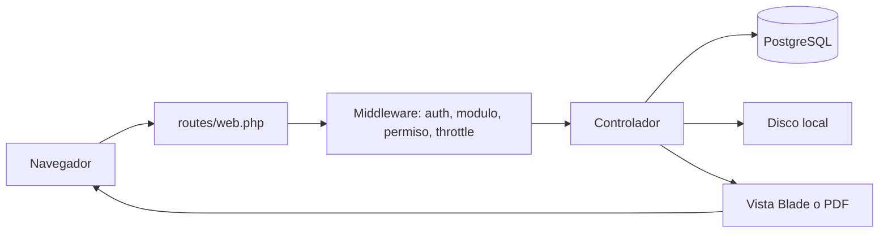
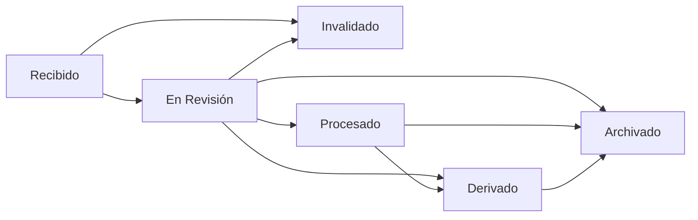

# Know-how del proyecto CGP

Cómo funciona el sistema de la Contraloría del Municipio Páez, de punta a punta. Está escrito para quien llega nuevo al proyecto y necesita entenderlo, ejecutarlo o modificarlo.

Se basa en el código del commit `ac553ad` (18/10/2026). Si este documento y el código no coinciden, manda el código.

## 1. Qué es

Un portal web con tres partes en una sola aplicación:

| Parte | URL | Para quién | Qué hace |
|---|---|---|---|
| Portal público | `/`, `/denuncias`, etc. | Ciudadanos, sin inicio de sesión | Informa, recibe trámites y muestra el estatus |
| Panel OAC | `/oac` | Oficina de Atención al Ciudadano | Gestiona expedientes, reportes y catálogos |
| Panel de Administración | `/admin` | Administradores y gestores de contenido | Gestiona usuarios, permisos, monitoreo y contenido web |

**OAC y DAC:** el código y el trabajo escrito dicen "OAC" (Oficina). El Manual de la institución dice "DAC" (Dirección). Son la misma unidad.

## 2. Tecnología

| Capa | Herramienta |
|---|---|
| Lenguaje y framework | PHP 8.4 (en Docker), Laravel 13 |
| Base de datos | PostgreSQL 17 |
| Interfaz | Vistas Blade, CSS propio, Bootstrap y JavaScript sin framework |
| PDF | `barryvdh/laravel-dompdf` |
| Ejecución | Docker Compose, con `php artisan serve` |
| Pruebas | PHPUnit |

Es un monolito MVC: no hay API separada ni aplicación móvil. `php artisan serve` es un servidor de desarrollo; **el repositorio no incluye configuración de producción** (HTTPS, servidor web ni respaldos).

## 3. Mapa del repositorio

```text
git/
├── design/                 Maqueta HTML estática; no es el sistema en funcionamiento
└── cgp-laravel/
    ├── app/
    │   ├── Console/Commands/CrearAdmin.php   Comando cgp:admin
    │   ├── Http/Controllers/
    │   │   ├── DenunciaController.php        Formulario, estatus y planilla
    │   │   ├── AuthController.php            Inicio y cierre de sesión
    │   │   ├── CatalogoController.php        Catálogos de ambos paneles
    │   │   ├── Oac/                          Expedientes y reportes
    │   │   └── Admin/                        Inicio, usuarios, monitoreo, contenido, informes
    │   ├── Http/Middleware/                  AccesoModulo y RequierePrivilegio
    │   └── Models/                           StaffUser, CaseFile, Citizen, Respondent...
    ├── database/
    │   ├── sql/db.sql                        Esquema principal
    │   ├── sql/completo.sql                  Consolidado de referencia; Laravel no lo lee
    │   └── migrations/                       Cambios posteriores al esquema
    ├── docs/                                 Instalación, usuarios y este documento
    ├── public/assets/                        CSS, JS (wizard.js), imágenes y leyes en PDF
    ├── resources/views/                      Vistas Blade
    ├── routes/web.php                        Todas las rutas web
    ├── routes/console.php                    Comando cgp:usuario
    ├── storage/app/private/                  Archivos subidos
    └── tests/Feature/PanelAdminTest.php      Pruebas principales
```

## 4. Cómo levantarlo

Los pasos completos están en [EJECUTAR.md](EJECUTAR.md) y [EJECUTAR_WINDOWS.md](EJECUTAR_WINDOWS.md). Resumen para Linux, una vez creado `.env` e instaladas las dependencias:

```bash
docker compose up -d --build
```

```bash
docker compose exec app php artisan key:generate
```

```bash
docker compose exec app php artisan migrate
```

```bash
docker compose exec app php artisan cgp:admin
```

El sistema queda en <http://localhost:8001>. Los paneles entran por `/admin/login` y `/oac/login`.

| Contenedor | Función | Puerto |
|---|---|---|
| `cgp-laravel-app` | Aplicación | 8001 → 8000 |
| `cgp-postgres` | Base de datos | 5432 |

**Cuidado:** `docker compose down -v` borra la base de datos. Para apagar sin riesgo usa `docker compose stop`.

## 5. Recorrido de una petición



Para encontrar cualquier función, empieza por la URL en `routes/web.php`: ahí ves su controlador y el permiso que exige.

## 6. Portal público

| Ruta | Función |
|---|---|
| `/` | Portada: servicios, preguntas frecuentes, misión, visión, noticias, Instagram y base normativa |
| `/denuncias` | Formulario de trámites |
| `/denuncias/estado?codigo=` | Consulta de estatus, con límite de 30 consultas por minuto |
| `/denuncias/{código}/planilla` | Planilla PDF |
| `/contraloria-escolar`, `/gestion-comunitaria` | Informes publicados |
| `/organigrama` | Página fija |

Misión, visión y noticias salen del gestor de contenido. Si no hay nada publicado, la portada usa su texto fijo.

### Flujo de un trámite

1. El ciudadano lee las consideraciones previas y elige Denuncia, Queja, Reclamo, Petición o Sugerencia.
2. Completa 6 pasos: Tipo, Ciudadano, Señalado, Hechos, Evidencias y Revisión. `wizard.js` valida cada paso y el navegador guarda un borrador durante 2 horas.
3. El formulario envía `POST /denuncias` con los datos en JSON y los archivos.
4. `DenunciaController@store` valida y guarda todo en una sola transacción.
5. La base de datos genera el número de expediente, por ejemplo `OAC-2026-00001`, y el código de seguimiento.
6. El ciudadano recibe su número y la planilla PDF, que debe firmar y consignar en papel.

### Reglas principales

- No se admiten trámites anónimos: la identificación es obligatoria.
- La narración debe tener entre 50 y 3500 caracteres.
- Cada adjunto puede pesar hasta 10 MB.
- Los campos de consulta popular solo aplican a denuncias.
- Si la misma cédula vuelve, se reutiliza el ciudadano y se actualizan sus datos.

### Lo que se valida solo en el navegador

Enviando la petición directamente al servidor, estas reglas no se aplican:

- Formato de cédula: el navegador exige de 5 a 10 dígitos; el servidor solo exige texto de hasta 12 caracteres.
- Al menos un señalado.
- Tipos de archivo permitidos.

Conviene reforzarlas en `DenunciaController@store`.

## 7. Panel OAC

| Sección | Permiso | Función |
|---|---|---|
| Inicio | Cualquier permiso de OAC | Indicadores y últimos movimientos, si tiene `CASES` |
| Expedientes | `CASES` | Lista, filtros, detalle y evidencias |
| Clasificación y derivación | `CLASSIFY` | Tipificar la irregularidad y derivar |
| Reportes | `REPORTS` | Indicadores por fechas y descarga CSV |
| Catálogos | `CATALOGS` | Trámites, irregularidades, unidades, señalados y documentos |

### Estados del expediente



- El mapa de transiciones está en `ExpedienteController::TRANSICIONES`.
- Archivado e Invalidado son estados finales.
- **Protocolizar** es pasar a En Revisión: guarda fecha y funcionario, y un trigger calcula el plazo de soportes.
- Cada actuación exige una observación de 5 a 2000 caracteres.
- Un bloqueo de fila evita que dos personas muevan el mismo expediente a la vez.

## 8. Panel de Administración

| Sección | Permiso | Función |
|---|---|---|
| Usuarios | `USERS` | Crear, listar, activar y desactivar |
| Permisos | `ACCESS` (escritura) | Asignar permisos; cada cambio queda auditado |
| Monitoreo | `STATS` (`ACCESS` para actuar) | Sesiones, accesos denegados, bloqueos y uso de disco |
| Cargos | `USERS` | Catálogo de cargos |
| Contenido web | `CMS` | Noticias, misión y visión, con historial de versiones |
| Informes | `CMS` (`delete` para eliminar) | PDF de Contraloría Escolar y Gestión Comunitaria |

## 9. Seguridad y permisos

**No hay roles fijos.** Cada usuario tiene leer, escribir o borrar por módulo. "Analista" o "Director" son solo cargos.

| Panel | Módulos |
|---|---|
| OAC | `CASES`, `CLASSIFY`, `CATALOGS`, `REPORTS` |
| Administración | `USERS`, `ACCESS`, `STATS`, `CMS` |

- `modulo:oac` o `modulo:admin` deja entrar a quien pueda leer algún módulo de ese panel.
- `permiso:CASES,write` protege cada ruta. Una negativa devuelve 403 y queda registrada.
- Un usuario nuevo nace **sin permisos**.
- Nadie puede cambiar sus propios permisos ni desactivar su propia cuenta.
- No se puede desactivar al único administrador de accesos.
- Hay bloqueo de 15 minutos tras 5 intentos fallidos y la sesión dura 120 minutos.

**Sin implementar:** recuperar contraseña por correo, cambiarla desde el panel, doble factor, captcha y registro de quién lee un expediente. La clave se cambia por consola; ver [CREAR_USUARIO.md](CREAR_USUARIO.md).

## 10. Base de datos

El esquema nace en `database/sql/db.sql`, que carga la migración `create_cgp_schema`. Los cambios posteriores están en `database/migrations/`. En total hay 37 tablas: 28 del sistema y 9 de Laravel.

| Grupo | Tablas |
|---|---|
| Catálogos | `claim_type`, `irregularity_type`, `case_status`, `referral_unit`, `respondent_type`, `id_document_type`, `physical_doc_type`, `job_position`, `app_module`, `cms_content_type` |
| Personal | `staff_user`, `staff_privilege`, `session_log` |
| Casos | `citizen`, `annual_sequence`, `case_file`, `popular_consultation`, `respondent` |
| Documentos | `evidence_file`, `case_physical_doc`, `scanned_minute` |
| Auditoría | `case_status_log`, `case_action`, `access_audit_log`, `unauthorized_access_log` |
| Portal | `cms_content`, `cms_content_version`, `web_report` |

### Lógica que vive en la base de datos

| Función | Qué hace |
|---|---|
| `fn_generate_case_number` | Genera el número `OAC-AÑO-NNNNN` |
| `fn_initial_status`, `fn_log_status_change` | Registran el historial de estatus |
| `fn_set_docs_deadline` | Calcula el plazo de soportes: 7 días calendario |
| `fn_protect_active_position` | Impide borrar un cargo con personal activo |
| `fn_updated_at` | Actualiza `updated_at` |

**Si buscas dónde se genera el número de expediente, no está en PHP: está en un trigger.**

### Existe, pero no se usa

- Tabla `scanned_minute` y vistas `v_public_case_tracking` y `v_case_detail`.
- Columnas `qr_payload`, `receipt_pdf_url`, `sigece_reference`, `incident_date`, `physical_docs_submitted`, `physical_docs_date`, `physical_file_number` y `cms_content.image_path`.
- La tabla `users` de Laravel: el personal inicia sesión con `staff_user`.

El catálogo `irregularity_type` nace vacío; hay que cargarlo antes de tipificar.

## 11. Archivos

Los archivos subidos van al disco local, en `storage/app/private/`: `evidencias/{id del expediente}/` e `informes/`. La base de datos solo guarda su ruta o nombre. **Un respaldo debe incluir la base de datos y esta carpeta.**

## 12. Cómo hacer cambios frecuentes

| Quiero... | Dónde |
|---|---|
| Añadir una ruta | `routes/web.php`, con su `permiso:` si es interna |
| Cambiar la base de datos | Una migración nueva; no edites `db.sql` |
| Cambiar una regla del formulario | `DenunciaController@store` **y** `public/assets/js/wizard.js` |
| Añadir un catálogo | La constante `CATALOGOS` y `POR_MODULO` de `CatalogoController` |
| Cambiar el flujo de estatus | `ExpedienteController::TRANSICIONES` y `ACCIONES` |
| Cambiar la planilla | `resources/views/pdf/planilla.blade.php` |
| Cambiar estilos | `public/assets/css/` (`contraloria`, `denuncias`, `oac`, `web`) |
| Crear un administrador | `php artisan cgp:admin` |
| Restablecer una clave | `php artisan cgp:usuario correo` (además da acceso total) |

## 13. Pruebas

```bash
docker compose exec app php artisan test
```

Usan la base `cgp_test` (ver [EJECUTAR.md](EJECUTAR.md)). **Si existe `bootstrap/cache/config.php`, ejecuta antes `php artisan optimize:clear`:** con la configuración en caché, las pruebas podrían vaciar la base de desarrollo.

Último resultado verificado: 22 pruebas, 251 aserciones, 21 aprobadas y 1 fallida. `test_imagenes_del_cms` falla porque prueba una función retirada, así que hay que actualizarla o eliminarla.

No hay pruebas automatizadas del envío público de trámites ni de la planilla PDF.

## 14. Lo que el sistema no hace

No lo presentes como función existente:

- Código QR, firma electrónica, integración con SIGECE.
- Notificaciones o correos al ciudadano.
- Semaforización o alertas de plazos, y cálculo de días hábiles.
- Estado de subsanación y control de consignación de soportes.
- Actas, oficios, autos o informes de valoración; solo genera la planilla.
- Editar los datos de un usuario existente.
- Línea de tiempo pública: el ciudadano solo ve el estatus actual.
- Exportar reportes a PDF; solo pantalla y CSV.
- Almacenamiento en la nube, HTTPS y respaldos automáticos.

**Aviso conocido:** el reporte de soportes vencidos puede listar expedientes que sí consignaron, porque ninguna pantalla marca la consignación.

**Antes de producción:**
- Configura HTTPS y un servidor web real.
- Programa respaldos.
- Pon `APP_DEBUG=false`.
- Cambia las claves por defecto.
- Refuerza las validaciones del servidor de la sección 6.

## 15. Problemas frecuentes

| Síntoma | Qué revisar |
|---|---|
| Un usuario no puede entrar a ningún panel | Nace sin permisos: asígnalos en su ficha |
| Cuenta bloqueada | Desbloquéala en Monitoreo o espera 15 minutos |
| `relation "staff_user" does not exist` | Faltan las migraciones |
| Errores de permisos en `storage/` | Ver el apartado de permisos en [EJECUTAR.md](EJECUTAR.md) |
| Cambios de configuración sin efecto | `php artisan optimize:clear` |
| Lentitud en Windows | Ver [EJECUTAR_WINDOWS.md](EJECUTAR_WINDOWS.md) |
| Error al ver errores en vivo | `docker compose logs -f app` |

## 16. Documentos relacionados

- [EJECUTAR.md](EJECUTAR.md) y [EJECUTAR_WINDOWS.md](EJECUTAR_WINDOWS.md): instalación.
- [CREAR_USUARIO.md](CREAR_USUARIO.md): usuarios y permisos. **Corrección:** ese documento ubica `REPORTS` en Administración, pero pertenece a OAC. También atribuye a un trigger impedir que se desactive un cargo: eso lo hace `CatalogoController`, y el trigger solo impide borrarlo.
- [HANDOFF_TRABAJO.md](HANDOFF_TRABAJO.md): cotejo entre el sistema y el trabajo escrito.
