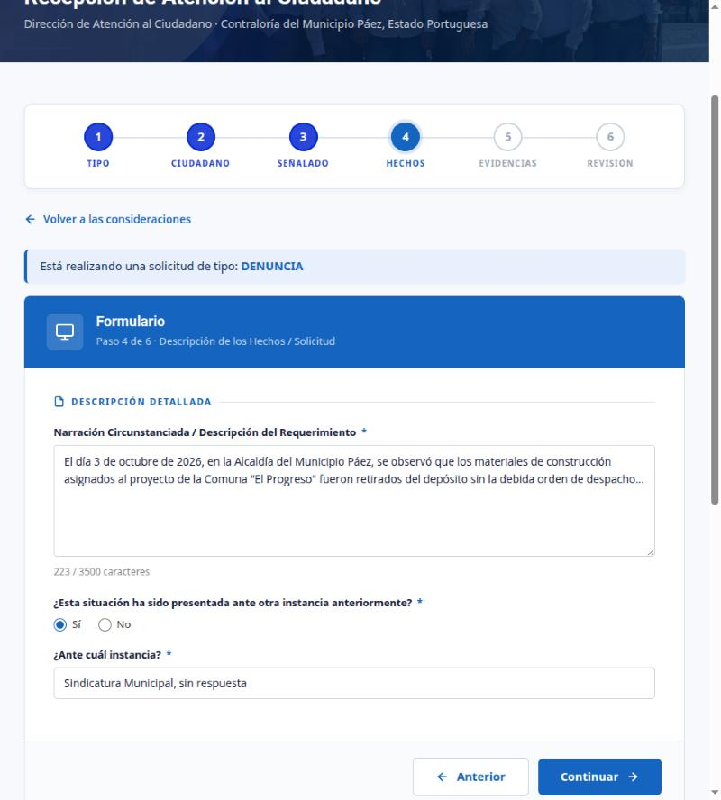
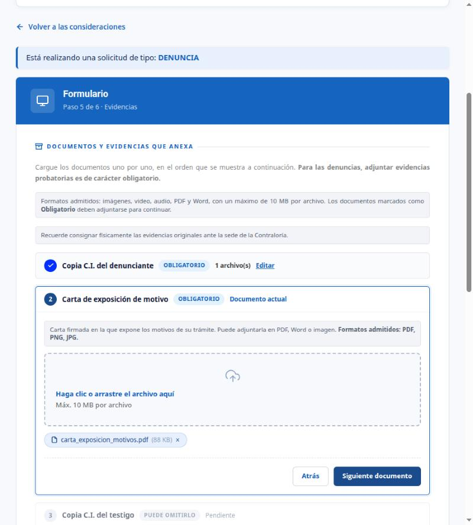
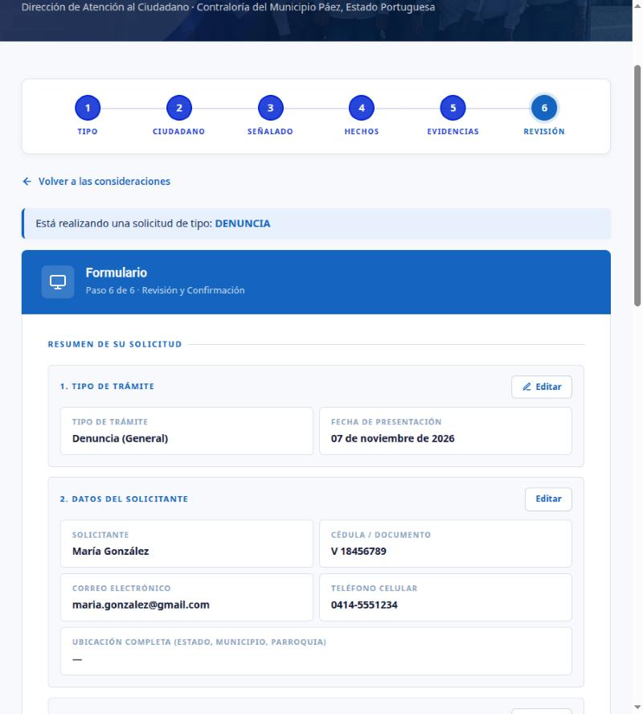
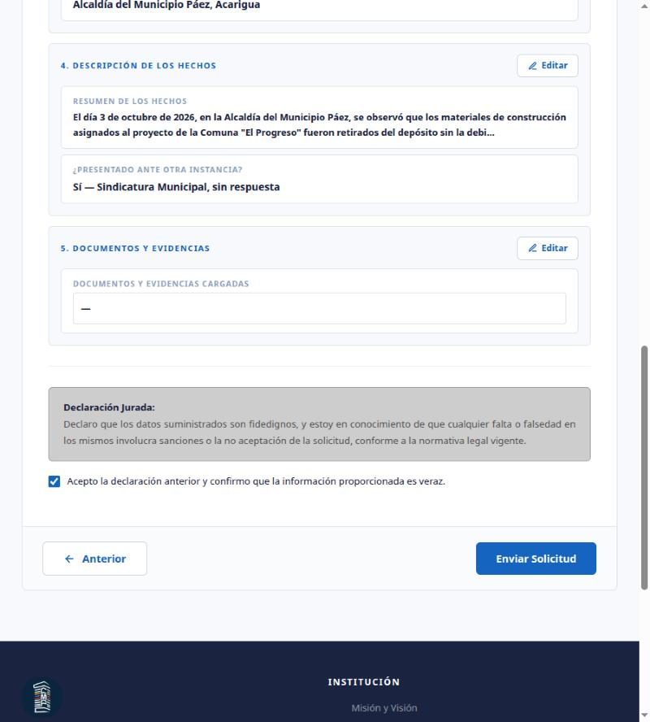
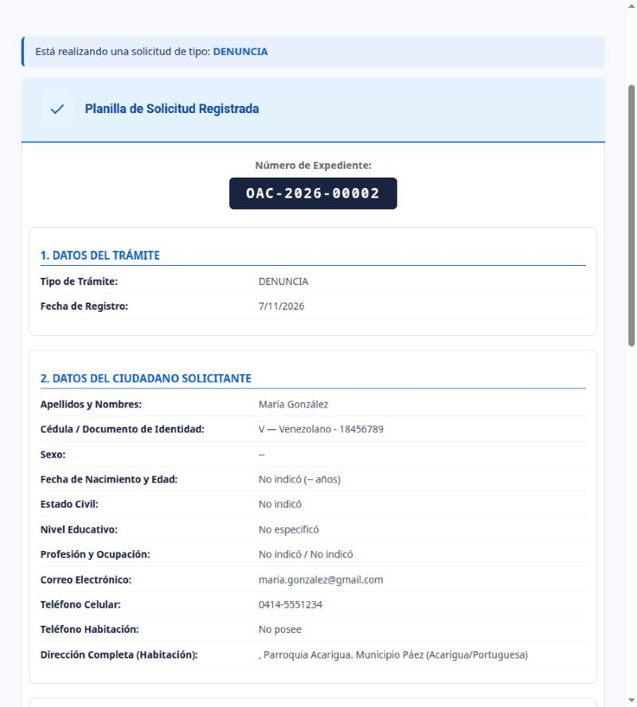
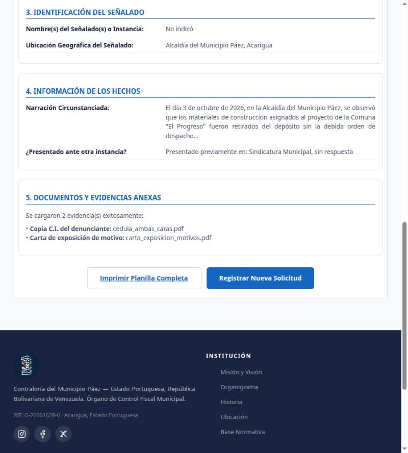
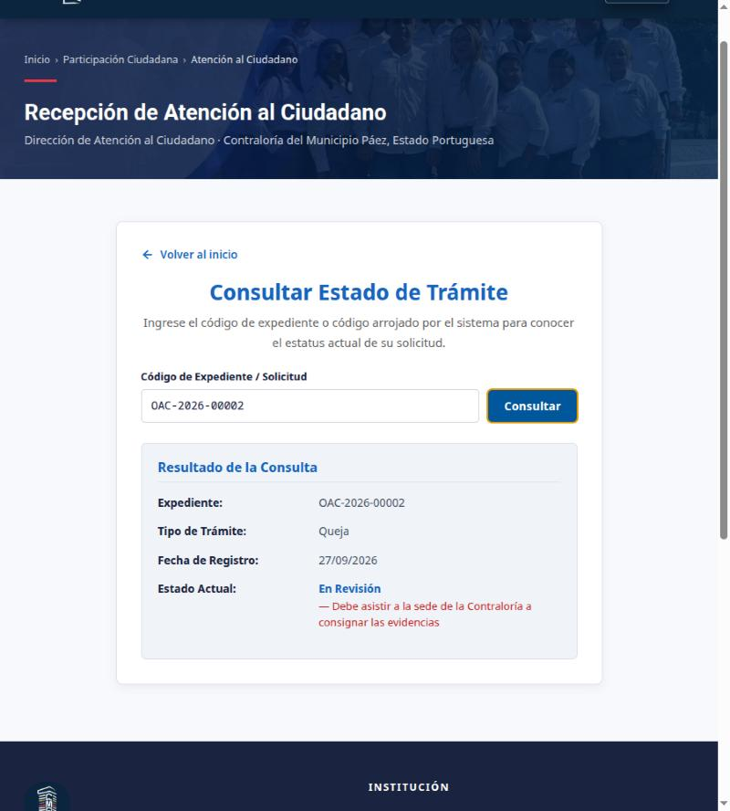

# Flujo de denuncia — desde Hechos hasta el seguimiento

(Pasos 1 a 3 — Tipo, Ciudadano y Señalado — los explica la compañera.)

## Paso 4 · Hechos
El ciudadano narra lo ocurrido (obligatorio, máx. 3500 caracteres) e indica si ya lo presentó ante otra instancia. Si dice "Sí", aparece "¿Ante cuál instancia?".

## Paso 5 · Evidencias
Los documentos se cargan uno por uno, en orden. Los marcados como OBLIGATORIO bloquean el avance; los demás "puede omitirlo". En una denuncia son obligatorias la cédula del denunciante y la carta de exposición de motivos. Se admiten imagen, video, audio, PDF o Word de hasta 10 MB. Cada documento ya cargado queda con ✓ y un botón "Editar".

## Paso 6 · Revisión
Resumen de todo lo cargado, con un botón "Editar" por sección que regresa a ese paso.

Para enviar hay que aceptar la Declaración Jurada. Al pulsar "Enviar Solicitud" el servidor:
1. valida los datos (documento, señalados y tipo de archivo);
2. rechaza los duplicados (mismo ciudadano, tipo y narración en menos de 5 min);
3. crea o actualiza al ciudadano, crea el expediente en estado RECIBIDO, guarda los señalados y los archivos;
4. la base de datos genera el número de expediente (OAC-AAAA-NNNNN) y el código de seguimiento.

## Confirmación · Planilla
Muestra el número de expediente y la planilla completa. El ciudadano debe imprimirla y llevarla, con las evidencias físicas, a la sede de la Contraloría.

## Seguimiento · Estado de Trámite
Desde la portada de denuncias, "Estado de Trámite" pide el número de expediente y muestra solo el tipo, la fecha y el estado. Nunca muestra datos personales.

