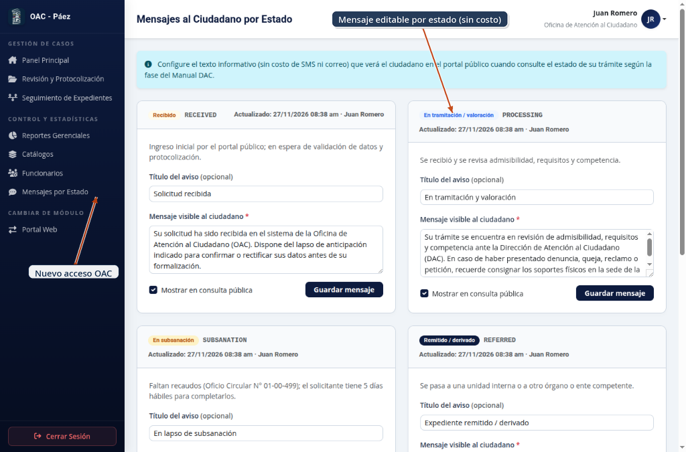
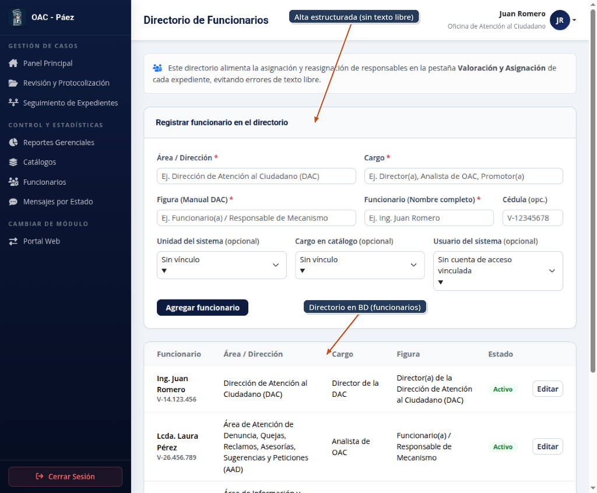
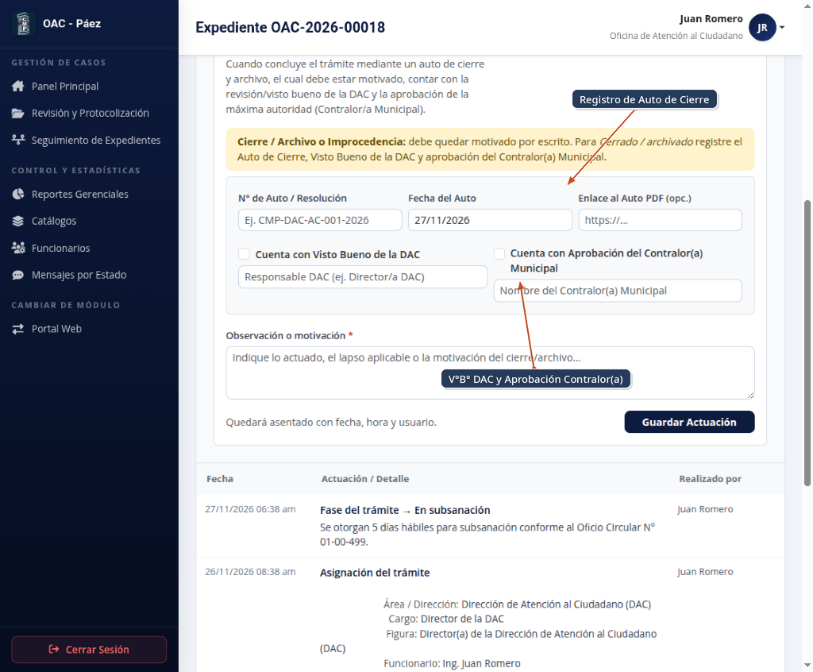
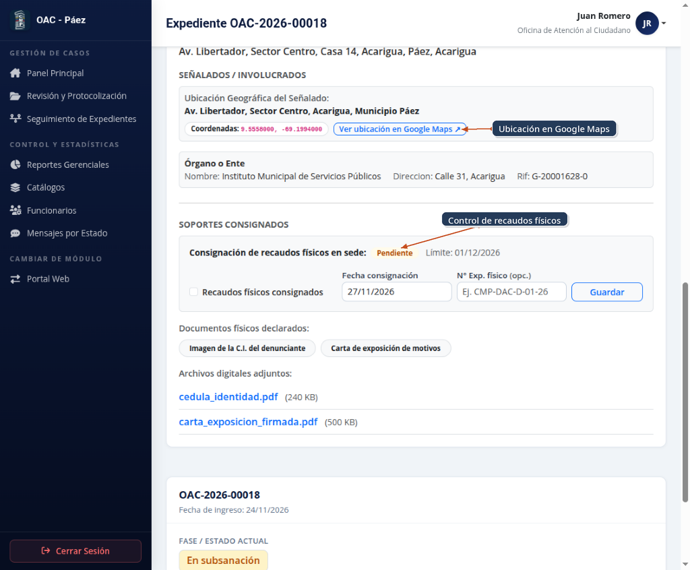
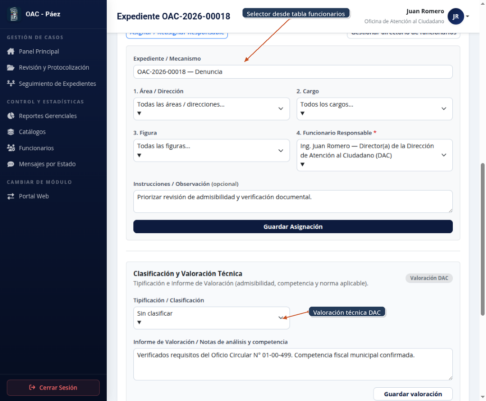
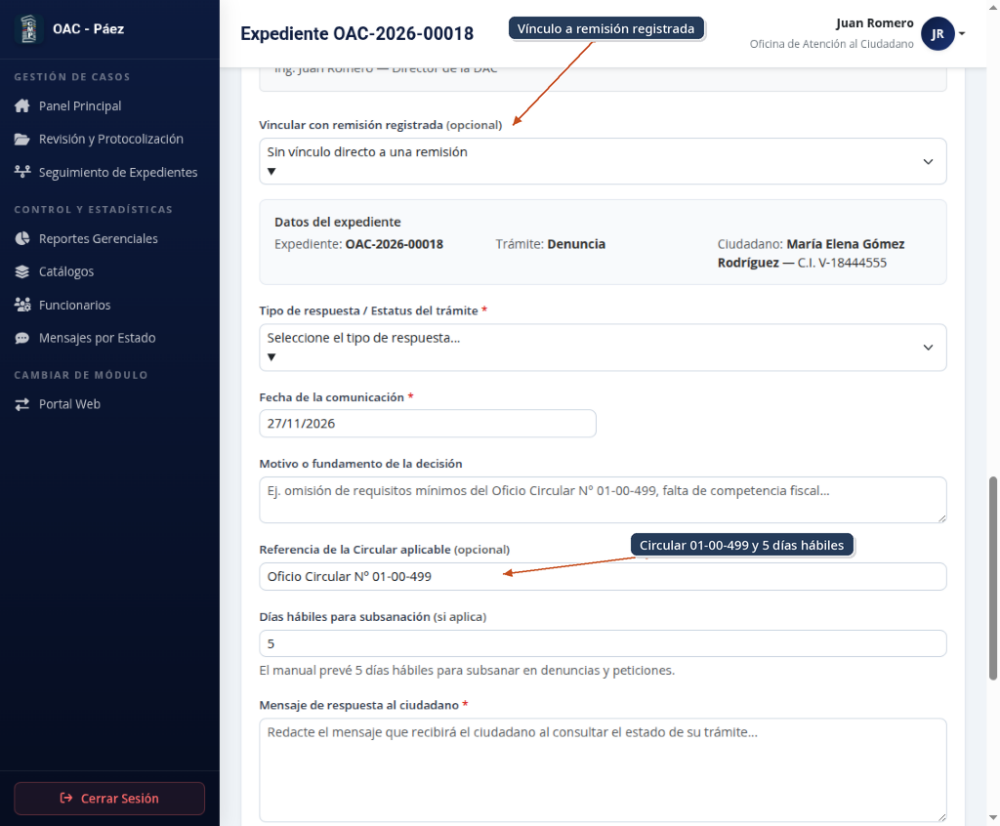
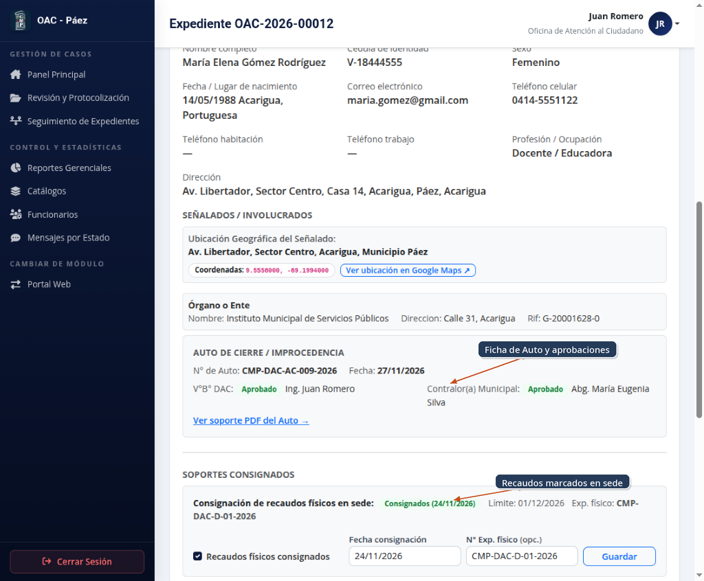
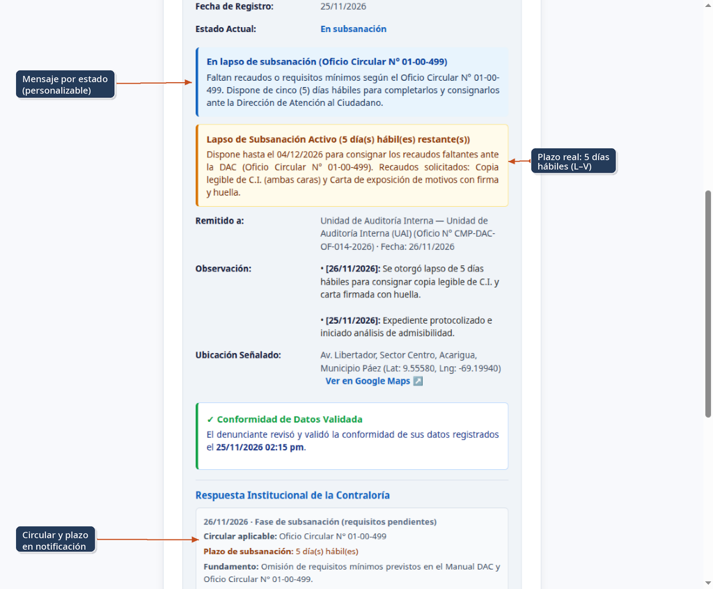
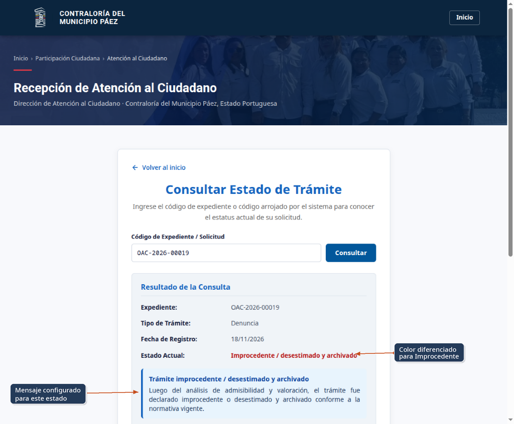
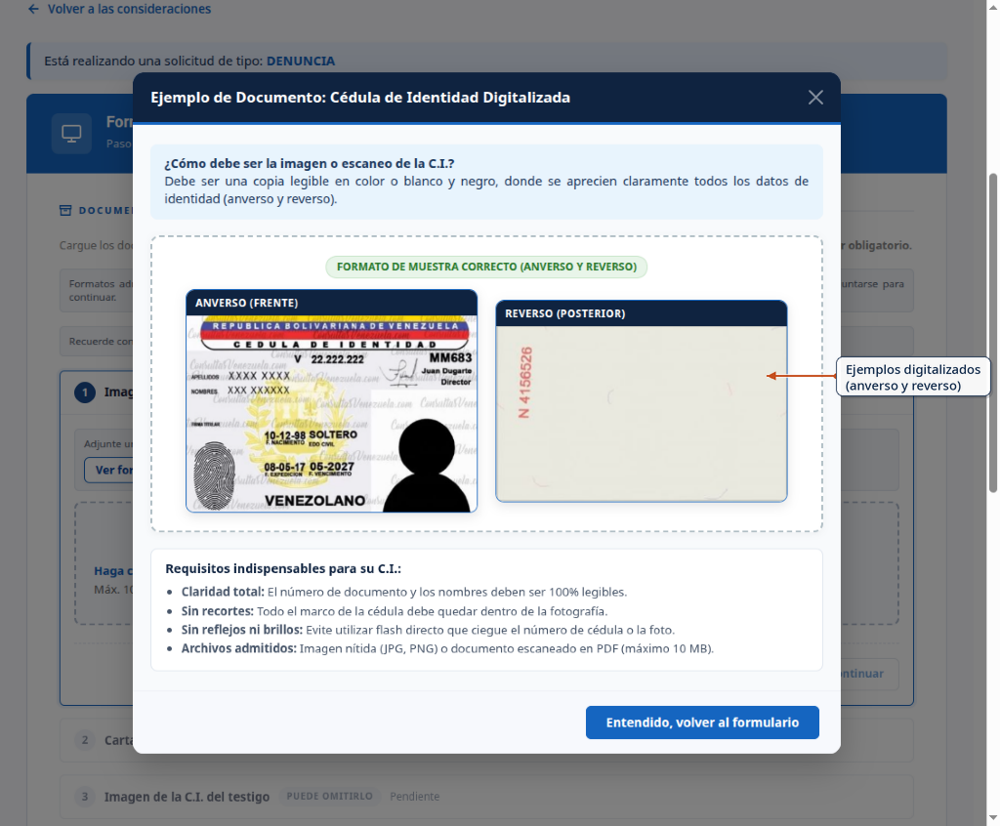

# Verificación de Interfaz — Cambios OAC (Contraloría del Municipio Páez)

> **Fecha:** 27 de noviembre de 2026  
> **Rama:** `main` (sin mezclar con `Programming`)  
> **Resolución de captura:** 1366 × 900 px (escritorio)  
> **Nota de entorno:** Las capturas corresponden a las plantillas Blade reales de `cgp-laravel` renderizadas con el motor Laravel y sus assets reales (`oac.css`, `denuncias.css`, `wizard.js`, Bootstrap 5, Leaflet) usando datos de demostración en memoria, ya que Docker/PostgreSQL estuvo inactivo en el entorno local. Se verificaron **0 errores de consola** y **0 imágenes rotas** en todas las pantallas.

## Resumen de pruebas ejecutadas

| # | Pantalla / Flujo verificado | Resultado | Captura |
|---|---|---|---|
| 1 | Mensajes al ciudadano por estado (`/oac/mensajes-estado`) | OK | [01_mensajes_estado.png](./capturas-interfaz/01_mensajes_estado.png) |
| 2 | Directorio de funcionarios (`/oac/funcionarios`) | OK | [02_directorio_funcionarios.png](./capturas-interfaz/02_directorio_funcionarios.png) |
| 3 | Expediente: subsanación (5 días hábiles) + actuación de cierre motivado | OK | [03_expediente_actuacion_cierre.png](./capturas-interfaz/03_expediente_actuacion_cierre.png) |
| 4 | Expediente: Google Maps + control de recaudos físicos | OK | [04_expediente_recaudos_fisicos.png](./capturas-interfaz/04_expediente_recaudos_fisicos.png) |
| 5 | Valoración y Asignación con tabla `funcionarios` | OK | [05_valoracion_asignacion_funcionarios.png](./capturas-interfaz/05_valoracion_asignacion_funcionarios.png) |
| 6 | Remisión y Notificación formal en BD | OK | [06_remision_notificacion.png](./capturas-interfaz/06_remision_notificacion.png) |
| 7 | Expediente cerrado: ficha Auto de Cierre, V°B° DAC y Contralor | OK | [07_expediente_cerrado_auto.png](./capturas-interfaz/07_expediente_cerrado_auto.png) |
| 8 | Consulta pública: Subsanación + mensaje personalizado + remisión | OK | [08_consulta_publica_subsanacion.png](./capturas-interfaz/08_consulta_publica_subsanacion.png) |
| 9 | Consulta pública: Improcedente / desestimado y archivado | OK | [09_consulta_publica_improcedente.png](./capturas-interfaz/09_consulta_publica_improcedente.png) |
| 10 | Evidencias digitalizadas: modal ejemplo de C.I. | OK | [10_evidencias_ejemplo_ci.png](./capturas-interfaz/10_evidencias_ejemplo_ci.png) |

## Capturas

### 1. Mensajes al ciudadano por estado (sin costo)

### 2. Directorio de funcionarios

### 3. Expediente: subsanación y actuación de cierre motivado

### 4. Expediente: Google Maps y control de recaudos físicos

### 5. Valoración y Asignación (tabla de funcionarios)

### 6. Remisión y Notificación formal

### 7. Expediente cerrado (Auto de Cierre, V°B° DAC y Contralor)

### 8. Consulta pública — En subsanación

### 9. Consulta pública — Improcedente / desestimado y archivado

### 10. Evidencias con formato digitalizado (ejemplo C.I.)

## Observaciones menores detectadas
1. **Modal de confirmación entre pasos en `/denuncias` (`#modalConfirmacionPaso`):** conflicto de `z-index` con `.modal-backdrop` al avanzar entre pasos del asistente (`#modalEjemploDocumento` sí se muestra correctamente al frente).
2. **Doble flecha en algunos `<select>` de `/oac`:** en ciertos selectores se dibuja el chevron de Bootstrap junto con el indicador nativo.
3. **Indentación en el historial de asignación:** `.hist-nota` usa `white-space: pre-wrap`, reflejando espacios de indentación del template Blade en el bloque de asignación.
